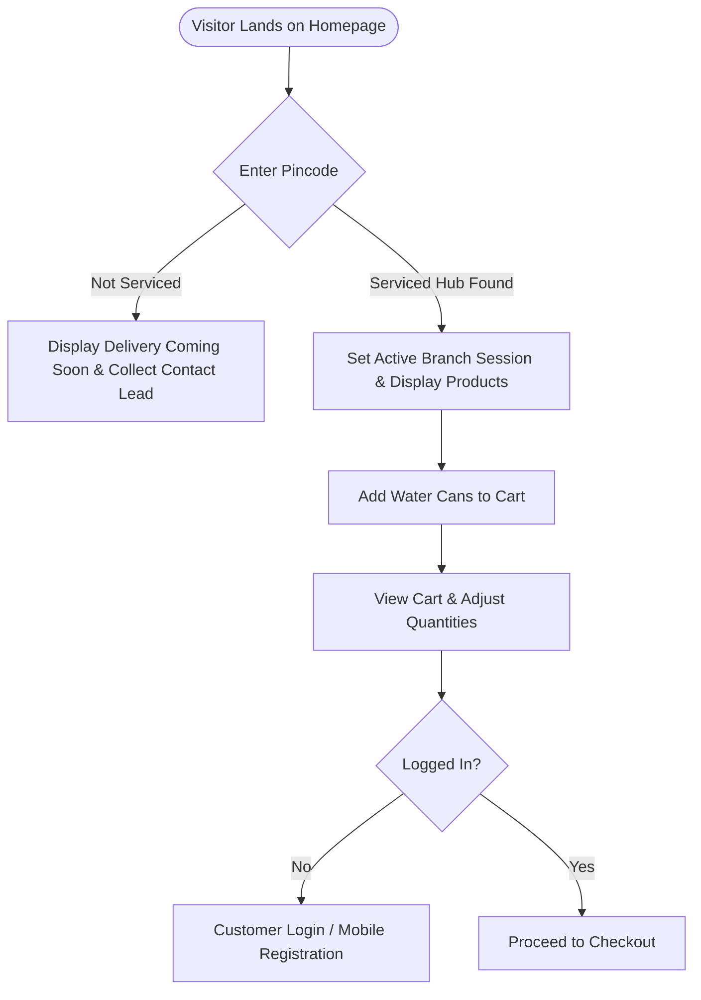
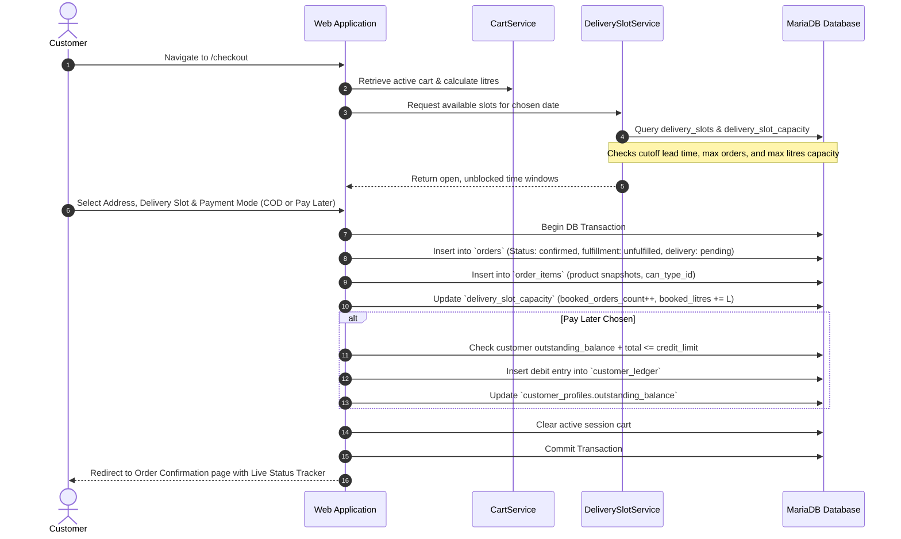
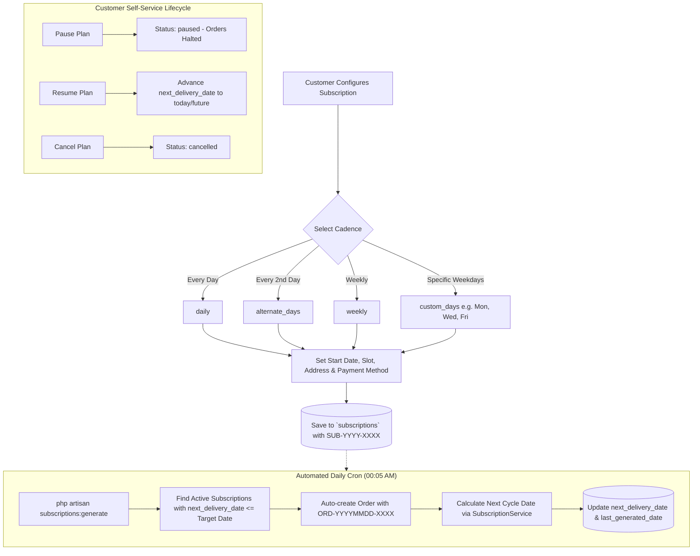
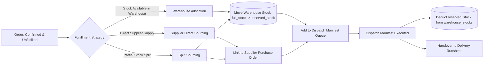
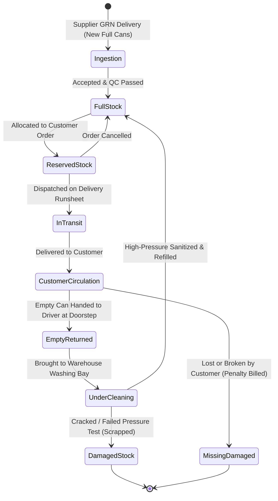
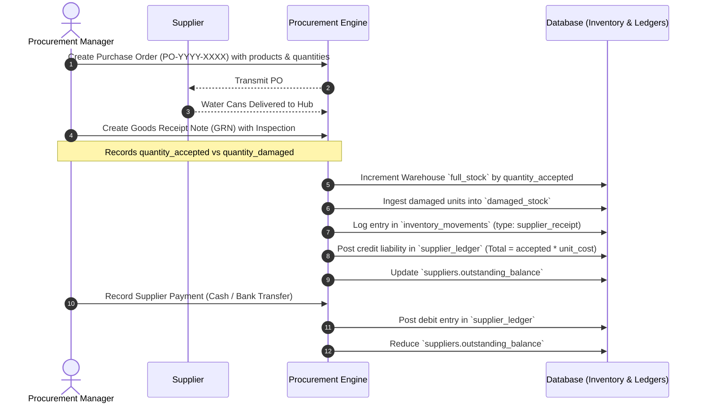
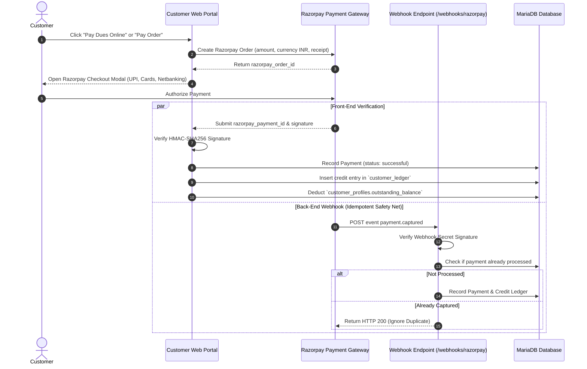
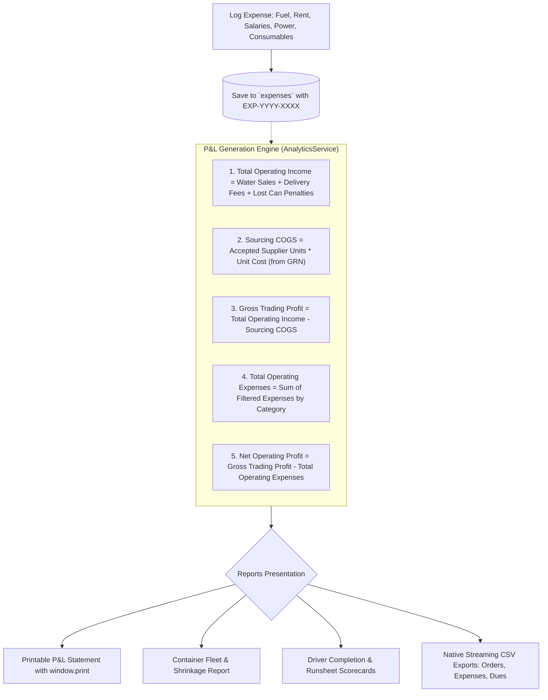
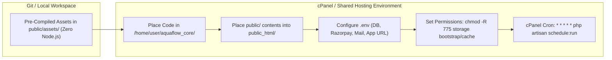

# AquaFlow Platform — End-to-End Business & Technical Workflow Manual

This document details the operational, financial, and logistical workflows of the **AquaFlow Water Can Ordering, Delivery Tracking, Inventory & Business Management Platform**.

---

## 1. System Actors & Roles Matrix

| Role Slug | Title | Key Responsibilities | Portal Access |
| :--- | :--- | :--- | :--- |
| `customer` | Residential / Commercial Customer | Orders water cans, manages recurring subscriptions, tracks deliveries, views financial passbook, settles dues online, tracks empty can container balances. | `/customer/*` |
| `delivery-staff` | In-House Delivery Driver | Operates mobile PWA runsheet, navigates stops, collects empty cans, collects COD cash, executes 4-digit OTP doorstep verification. | `/staff/*` |
| `delivery-supervisor`| Logistics Dispatcher | Schedules delivery trips, manages runsheets, allocates vehicles and 3rd-party partners, oversees slot capacity locks. | `/admin/delivery/*` |
| `inventory-manager` | Warehouse Operations Lead | Ingests full stock from suppliers, manages bottle washing/cleaning queues, logs damaged containers, initiates inter-hub transfers. | `/admin/inventory/*` |
| `order-manager` | Sourcing & Fulfillment Lead | Allocates order fulfillment between warehouse and supplier dropship, generates dispatch manifests and packing slips. | `/admin/orders/*`, `/admin/manifests/*` |
| `accounts-manager` | Finance & Ledger Accountant | Reviews customer ledgers, enforces B2B credit limits, records manual collections, tracks supplier payables, logs operating expenses. | `/admin/accounts/*`, `/admin/expenses/*` |
| `branch-manager` | Branch General Manager | Branch-level executive analytics, staff assignments, local customer approvals, inventory oversight. | Full Branch Scope |
| `super-admin` | Business Owner / Super Admin | Multi-branch consolidated P&L, global settings, supplier contracts, system maintenance, role delegation. | Full System Scope |

---

## 2. Public Storefront & Customer Onboarding Workflow



### Process Steps:
1. **Pincode Verification**: Visitor enters their 6-digit postal code. The AJAX endpoint (`POST /check-pincode`) queries `delivery_pincodes` linked to `delivery_zones` and `branches`.
   - If serviceable: Returns branch name and delivery turnaround time (e.g. "Delivered within 2 hours by Central Chennai Hub").
   - If unserviceable: Offers a lead inquiry form saving data into `contact_inquiries`.
2. **Catalog Browsing**: Real-time listing of available water cans (20L Premium, 10L Dispenser, Bisleri/Kinley 20L, etc.) with selling price, tax rate, and empty-can deposit requirement flags.
3. **Registration & KYC**: Customers register with Mobile Number, Name, Email, Password, and Delivery Address (House/Flat, Street, Area, Landmark, Pincode).
   - Residential customers: Instant activation with ₹500 standard credit limit.
   - Commercial/Corporate B2B customers: Created with company GSTIN and business name, queued for Credit Limit approval.

---

## 3. Order Placement & Slot Capacity Workflow



---

## 4. Recurring Subscriptions Lifecycle Workflow



---

## 5. Split-Fulfillment Engine & Sourcing Allocation

AquaFlow supports **Hybrid Sourcing**: An order can be fulfilled entirely from branch warehouse stock, directly dropshipped from an external supplier, or split between both.



### Database Impact:
- Table `order_fulfillments`: Records `fulfillment_type` (`warehouse` vs `supplier`), `quantity`, and status (`pending`, `packed`, `dispatched`).
- Table `dispatch_manifests`: Batches multiple fulfillments under sequential manifest `MAN-YYYYMMDD-XXXX` with vehicle number, driver name, and item checklist.

---

## 6. Multi-Category Inventory & Bottle Life-Cycle

Water can containers undergo a continuous multi-state physical rotation:



### Stock Balance Rules:
- Physical Warehouse Total = `full_stock + empty_stock + under_cleaning + damaged_stock`.
- Available to Sell = `full_stock - reserved_stock`.
- Reorder Trigger: When `(full_stock - reserved_stock) <= reorder_level`, an automated alert badge appears on the Admin Inventory console.

---

## 7. Supplier Procurement & Accounts Payable (AP)



---

## 8. Delivery Dispatch, Runsheet & Doorstep Verification

```mermaid
flowchart TD
    ScheduleTrips[Select Delivery Date & Slot] --> FilterOrders[Fetch Confirmed Orders Waiting for Dispatch]
    FilterOrders --> CreateRunsheet[Create Delivery Trip: TRIP-YYYYMMDD-XXXX]
    CreateRunsheet --> AssignDriver{Select Fleet Type}
    
    AssignDriver -->|In-House Driver| StaffDriver[Staff Profile & Vehicle Number]
    AssignDriver -->|3rd-Party Fleet| PartnerFleet[Delivery Partner e.g. Porter / Shadowfax]

    StaffDriver --> GenerateStops[Generate Sequential Stops & Compute 4-Digit OTPs]
    PartnerFleet --> GenerateStops

    GenerateStops --> DispatchTrip[Mark Trip: in_transit | Orders: out_for_delivery]

    subgraph DoorstepHandover ["Mobile PWA Doorstep Execution"]
        DriverArrives[Driver Arrives at Customer Address] --> RequestOTP[Request 4-Digit PIN from Customer]
        RequestOTP --> VerifyOTP{Enter OTP in Staff PWA}
        
        VerifyOTP -- "Invalid PIN" --> OTPError[Reject Delivery Handover]
        VerifyOTP -- "Valid PIN" --> HandoverSuccess[Record Delivered Cans]
        
        HandoverSuccess --> CollectEmpties[Input Number of Empty Cans Returned]
        HandoverSuccess --> CollectCOD[Collect Cash Amount if COD]
        
        CollectEmpties --> CompleteStop[Mark Stop: delivered | Order: delivered]
        CompleteStop --> UpdateCanBalance[(Update customer_can_balances & can_movements)]
        CompleteStop --> RecordCashPayment[(Insert into payments & credit ledger)]
    end

    DispatchTrip --> DoorstepHandover
```

---

## 9. Empty-Can Exchange Management & Financial Segregation

AquaFlow enforces strict segregation between **physical container units** and **customer financial currency**:

| Dimension | Physical Container Ledger (`can_movements`) | Financial Accounts Ledger (`customer_ledger`) |
| :--- | :--- | :--- |
| **Unit of Measure** | Integer bottle count (units) | INR Currency (₹) |
| **Primary Table** | `can_movements` & `customer_can_balances` | `customer_ledger` & `customer_profiles` |
| **Normal Delivery** | Full Delivered (+2), Empty Returned (-2) &rarr; Net change: 0 | Cash paid (+₹160), Order charge (-₹160) &rarr; Net change: 0 |
| **Fewer Empties Returned** | Full Delivered (+2), Empty Returned (-0) &rarr; Customer holding increases (+2) | Financial balance unchanged (customer owes bottle, not money yet) |
| **Lost / Broken Can Penalty** | Movement logged: `lost_by_customer` (-1 can holding) | Automated debit entry: ₹150 penalty billed to financial ledger |

---

## 10. Financial Accounts & Razorpay Integration Workflow



---

## 11. Operating Expenses & Business Analytics (P&L) Workflow



---

## 12. Progressive Web App (PWA) Offline Workflow

```mermaid
flowchart TD
    UserDevice[User Device / Browser] --> ServiceWorker{Service Worker (sw.js)}

    ServiceWorker --> CheckRoute{Route Type}

    CheckRoute -->|Static Asset: CSS, JS, Images| CacheFirst[Cache-First Strategy]
    CacheFirst --> CacheHit{Asset in Cache?}
    CacheHit -- "Yes" --> ServeCache[Serve Immediately from Cache]
    CacheHit -- "No" --> FetchNet[Fetch from Network & Store in Cache]

    CheckRoute -->|Navigation: HTML Page| NetworkFirst[Network-First Strategy]
    NetworkFirst --> TryNetwork{Internet Connected?}
    TryNetwork -- "Connected" --> ServeFreshPage[Render Fresh Dynamic Blade View]
    TryNetwork -- "Offline / Network Fail" --> ServeOfflinePage[Serve Pre-cached /offline Fallback Page]

    CheckRoute -->|Sensitive: Checkout, Payments, Admin| NetworkOnly[Direct Network Only (Never Cached)]
```

---

## 13. Shared Hosting Deployment & Maintenance Workflow



### Zero-SSH Maintenance Actions:
Administrators without terminal access can manage production tasks directly from the Admin Console:
- **Storage Symlink Creation**: `POST /admin/utilities/storage-link` executes `Artisan::call('storage:link')`.
- **Cache Invalidation**: `POST /admin/utilities/optimize-clear` executes `Artisan::call('optimize:clear')`.
- **Manual Subscription Runsheet Generation**: `POST /admin/subscriptions/generate-manual` triggers batch dispatch generation for any given date.
